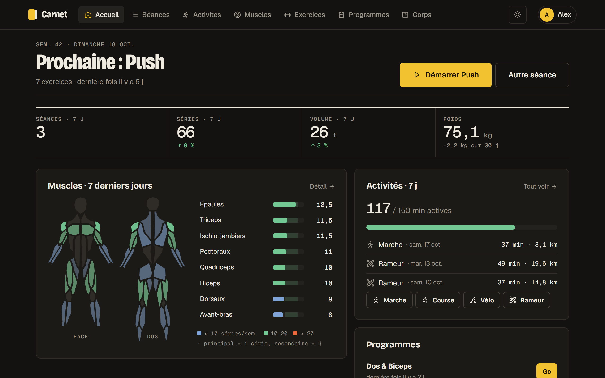
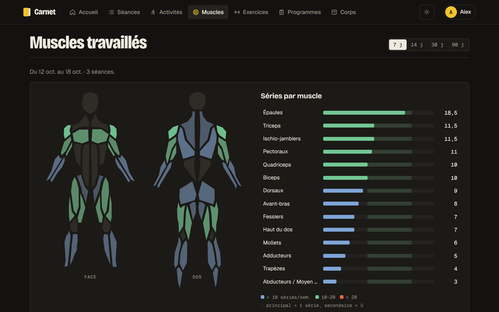
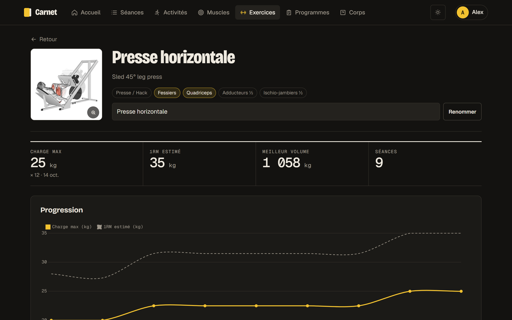
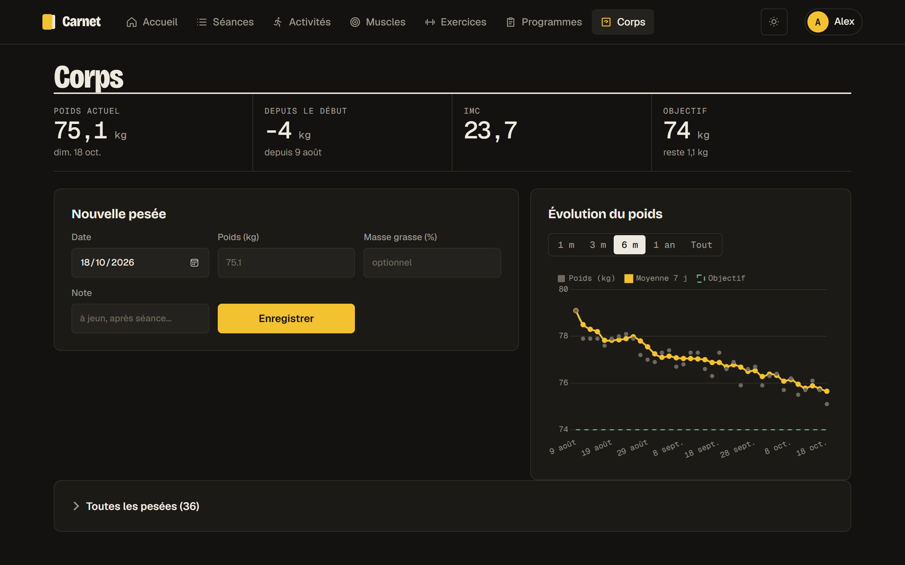
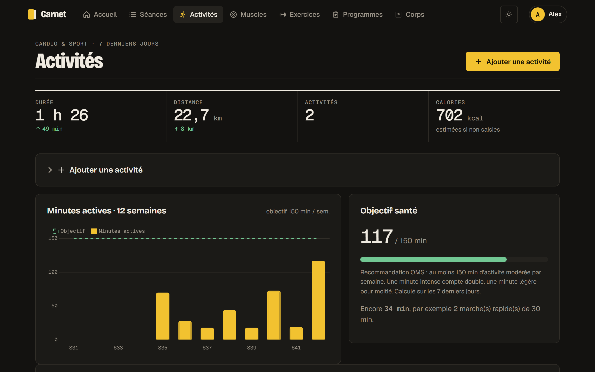
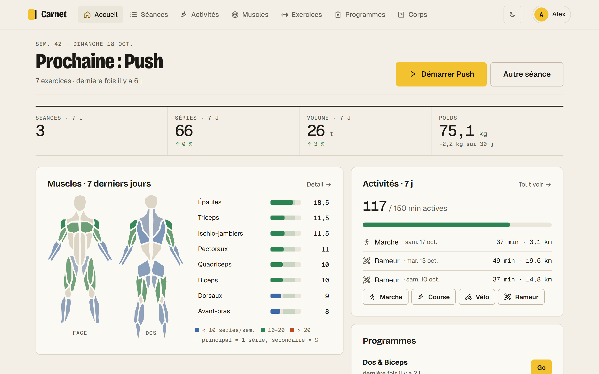
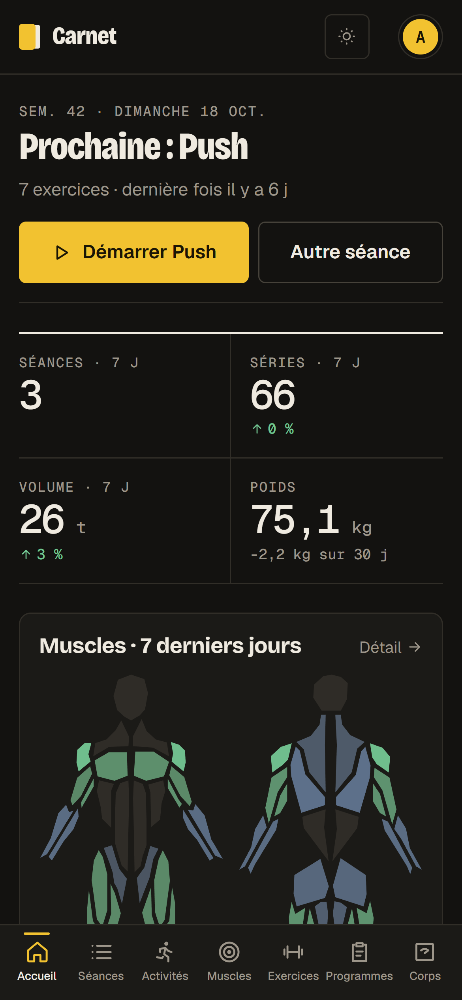
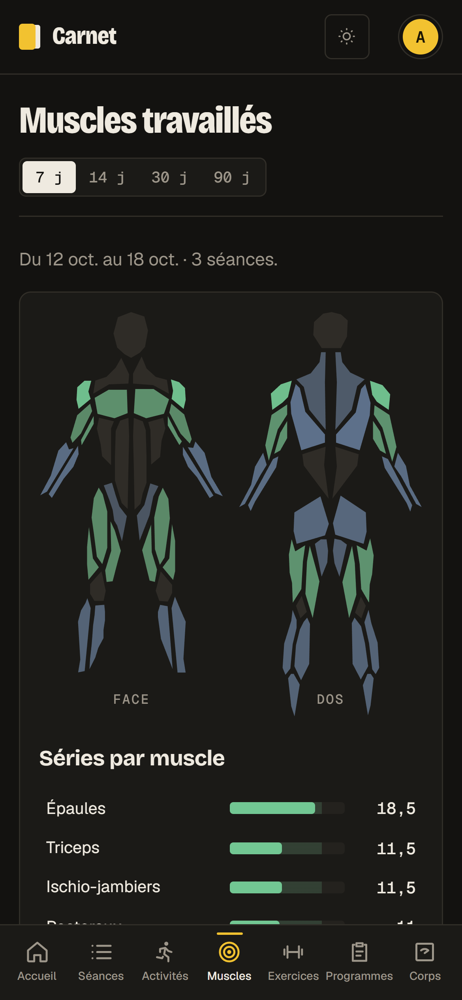

<div align="center">

# Carnet

**Carnet d'entraînement de musculation, auto-hébergé.**
Séances, surcharge progressive, muscles travaillés, activités cardio, poids et mensurations.




</div>

---

PHP natif + SQLite, sans framework, sans Composer, sans build : on copie le dossier sur un serveur et ça tourne.
Thème sombre (encre) et clair (papier), interface pensée pour le téléphone à la salle.

## Fonctions

| Module | Description |
|---|---|
| **Séance en cours** | Charges pré-remplies depuis la dernière séance, colonne « Préc. », coche qui remplit les reps et lance le minuteur de repos (bip + vibration), repos de transition annonçant l'exercice suivant, minuteur qui survit au rechargement, enregistrement automatique. |
| **Supersets et ordre** | Lier / délier en un clic (bi-set, tri-set, circuit), enchaînement sans repos ; exercices réordonnés au glisser-déposer, au doigt sur mobile. |
| **À la salle** | Remplacer un exercice quand la machine est prise (alternatives sur les mêmes muscles), notes de réglage machine, écran toujours allumé, application installable, saisies hors ligne synchronisées au retour du réseau. |
| **Surcharge progressive** | Règle par exercice (ex. « 4×12 validées → +5 kg ») : la séance suivante propose et pré-remplit la nouvelle charge. |
| **Muscles** | Séries par muscle sur 7 / 14 / 30 / 90 jours (principal = 1, secondaire = ½), silhouette colorée, comparaison avec la période précédente, zones 10–20 séries/semaine. |
| **1 324 exercices** | Recherche, filtres muscle/matériel, GIF, consignes en français, records (charge max, 1RM estimé, volume), courbe de progression, exercices perso. |
| **Programmes** | Création et modification : ordre, type, séries, reps, repos (entre séries et après l'exercice, en `1:30` ou en secondes), consigne, règle de surcharge. Jambes, Dos & Biceps et Push fournis. |
| **Activités** | 15 sports (course, vélo, rameur, natation…), allure / vitesse selon le sport, calories estimées (MET × poids), objectif OMS 150 min/semaine. |
| **Corps** | Pesées (moyenne 7 j, objectif, IMC), 12 mensurations avec courbes. |
| **Multi-comptes** | Données cloisonnées par compte, catalogue commun géré par l'admin, export JSON, suppression du compte. |

## Aperçu

<table>
  <tr>
    <td width="50%"></td>
    <td width="50%"></td>
  </tr>
  <tr>
    <td align="center"><sub>Muscles travaillés</sub></td>
    <td align="center"><sub>Fiche exercice & progression</sub></td>
  </tr>
  <tr>
    <td></td>
    <td></td>
  </tr>
  <tr>
    <td align="center"><sub>Poids & mensurations</sub></td>
    <td align="center"><sub>Activités cardio</sub></td>
  </tr>
  <tr>
    <td colspan="2"></td>
  </tr>
  <tr>
    <td colspan="2" align="center"><sub>Thème clair</sub></td>
  </tr>
</table>

<p align="center">
  
  &nbsp;&nbsp;
  
</p>

<p align="center"><sub>Captures réalisées avec des données de démonstration.</sub></p>

## Lancer en local

Prérequis : **PHP 8.1+** avec `pdo_sqlite`.

```bash
git clone https://github.com/dyzlek/carnet.git
cd carnet
php -d extension=pdo_sqlite -S 0.0.0.0:8000 router.php
```

Sous Windows, double-clic sur `start.bat` fait la même chose.

Ouvre http://localhost:8000 (depuis le téléphone sur le même Wi-Fi : `http://IP-DU-PC:8000`).
Au premier lancement, la base `data/muscu.sqlite` est créée et les 1 324 exercices sont importés.
Le **premier compte créé devient administrateur** ; les inscriptions sont ensuite fermées par défaut
(réouvrables dans *Mon compte → Administration*).

> L'option `-d extension=pdo_sqlite` active SQLite au lancement sans toucher au `php.ini`.
> Les images et GIF des exercices sont chargés depuis GitHub : il faut une connexion.

## Mettre en ligne

Apache ou nginx, PHP 8.1+, HTTPS. Tout est détaillé dans **[DEPLOIEMENT.md](DEPLOIEMENT.md)** :
paquet prêt à envoyer (`tools/build.php`), droits sur `data/`, configuration nginx,
et script de vérification `tools/check.php` qui teste le site depuis l'extérieur.

## Sécurité

- Mots de passe hachés (`password_hash`), jeton CSRF sur chaque formulaire et appel API
- Session renouvelée à la connexion, blocage après 8 essais ratés en 15 min
- CSP stricte sans script inline, `X-Frame-Options`, `nosniff`, `Referrer-Policy`, HSTS en HTTPS
- `data/`, `src/`, `pages/`, `tools/` inaccessibles depuis le web (`.htaccess` + `router.php`)
- Chart.js et polices hébergés localement (vérifiés par SRI) : aucun script chargé depuis un CDN

## Structure

```
index.php        routeur des pages (?p=…)
api.php          actions AJAX (séries, recherche, sauvegarde)
router.php       routeur du serveur PHP intégré (bloque data/, src/, pages/)
src/             bootstrap, base (schéma + import), requêtes, auth, sécurité, muscles
pages/           une page par fichier + _layout.php
assets/          app.css, app.js, thème, polices, Chart.js
data/            exercises.json (+ muscu.sqlite, sessions/ créés au lancement)
tools/           build.php, check.php, reset-password.php
```

## Crédits

- Exercices : [hasaneyldrm/exercises-dataset](https://github.com/hasaneyldrm/exercises-dataset) (MIT), images et GIF © Gym visual
- Silhouette anatomique : [react-body-highlighter](https://github.com/GV79/react-body-highlighter) (MIT)
- Icônes : [Tabler Icons](https://github.com/tabler/tabler-icons) (MIT)
- Graphiques : [Chart.js](https://www.chartjs.org/) (MIT)

Détails et licences complètes dans [THIRD_PARTY.md](THIRD_PARTY.md).

## Licence

[MIT](LICENSE) © dyzlek
